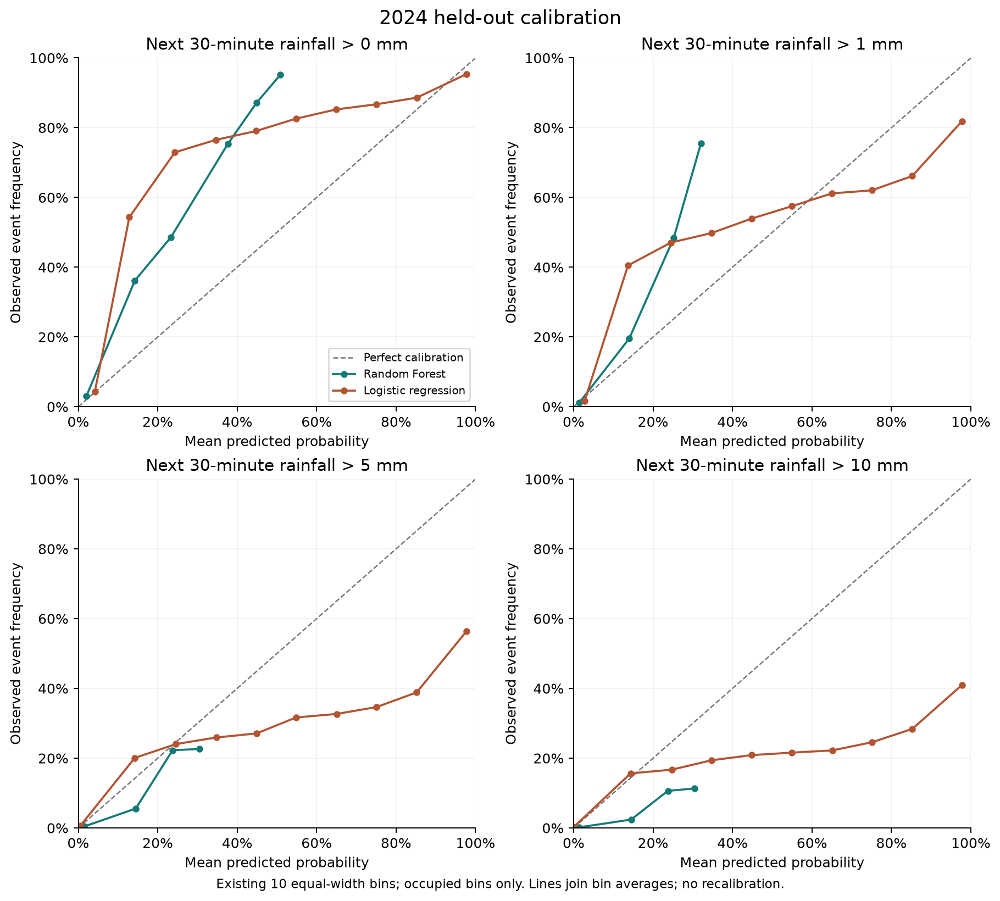
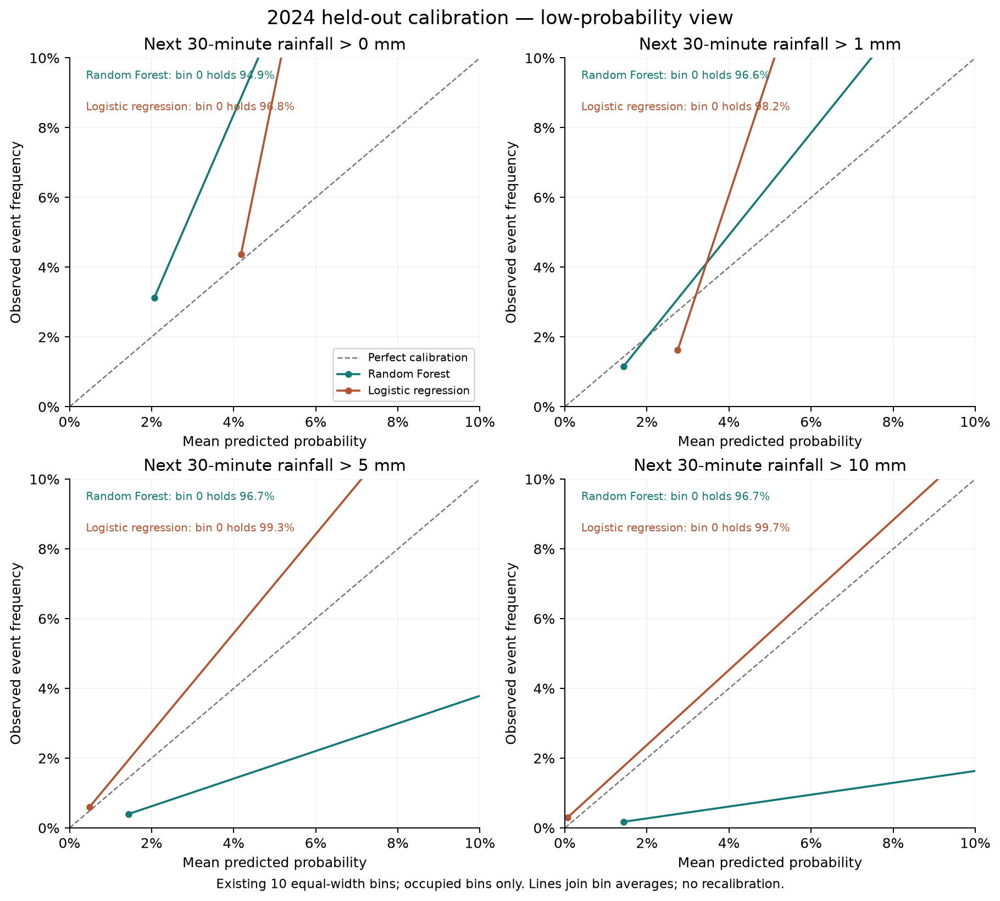
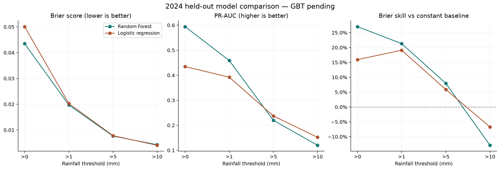

# Saved Task 2 results: RF and LR

GBT results are pending. This comparison uses frozen 2024 test outputs; no models were fitted or tuned.

| Threshold (mm) | RF Brier ↓ | LR Brier ↓ | RF PR-AUC ↑ | LR PR-AUC ↑ | RF Brier skill |
| --- | --- | --- | --- | --- | --- |
| >0 | 0.043471 | 0.050081 | 0.5942 | 0.4346 | 27.0% |
| >1 | 0.019710 | 0.020268 | 0.4587 | 0.3923 | 21.3% |
| >5 | 0.007650 | 0.007823 | 0.2197 | 0.2371 | 7.9% |
| >10 | 0.004305 | 0.004070 | 0.1200 | 0.1520 | -12.9% |

Mean Brier: RF 0.018784; LR 0.020560 (8.6% lower for RF).

RF improves Brier at 0, 1 and 5 mm; LR improves Brier at 10 mm. LR has better PR-AUC at 5 and 10 mm.
RF overestimates heavy-rain probability: at >10 mm its mean forecast is 2.0173%, versus 0.3828% observed.
RF Brier skill at >10 mm is negative: it loses to the training-prevalence constant forecast.

## Verification and limits

- Both manifests report complete runs; split/year counts and per-threshold test sample/positive counts agree.
- RF references exactly the archived LR manifest SHA256 for its shared prepared dataset.
- Matching counts and provenance support comparison; individual station/time test keys were not independently compared here.
- Calibration bins reconcile with all test sample counts, observed prevalence and mean predictions.
- AUC uses the same Spark 1000-bin approximation. Results are descriptive; no significance or independence claim is made.
- Calibration plots use saved ten-bin summaries. The low-probability plot magnifies these bins; it does not rebin predictions.
- No confidence intervals, recalibration or classification-cutoff tuning can be derived from these aggregate files alone.
- RF had zero adjacent threshold-monotonicity violations on this test cohort; this is not a model-wide guarantee.
- Do not use this test comparison to retune either model and still call 2024 untouched.
- Keep GBT pending until its final frozen results and shared dataset provenance are available.

